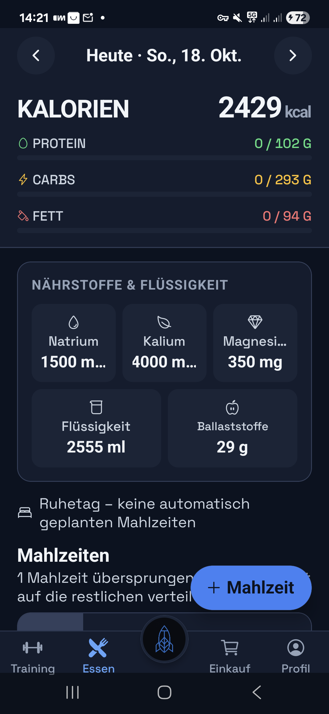
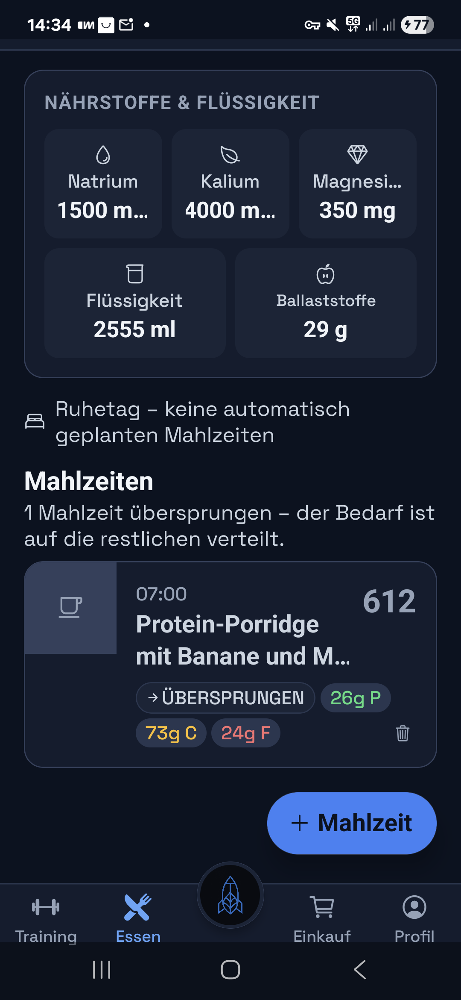
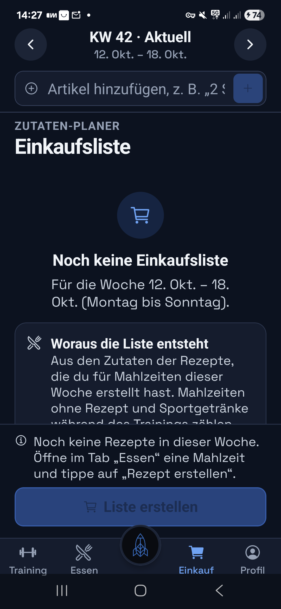
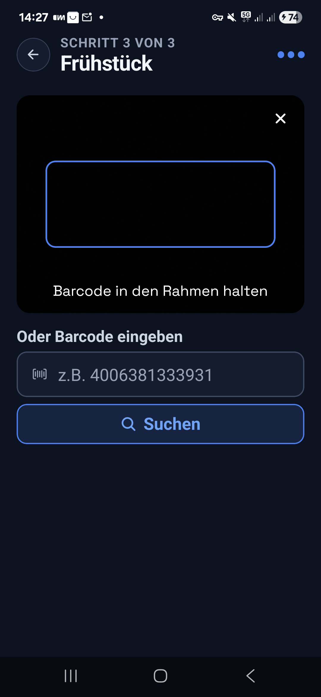
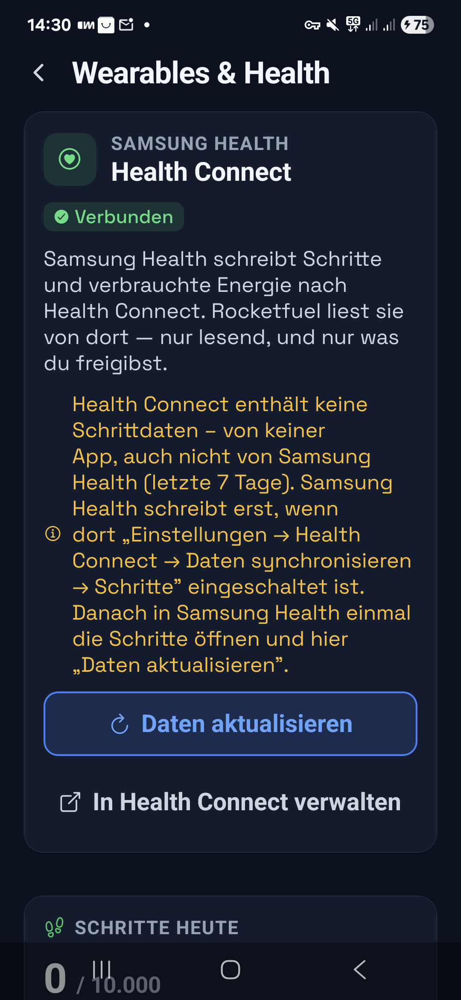

# Rocketfuel — Case Study

**KI-gestützte Trainings- & Ernährungs-App für Sportler.** Automatische Makronährstoff-, Peri-Workout- und Mahlzeitenplanung sowie Einkaufslisten auf Basis wissenschaftlicher Richtlinien (ACSM, ISSN, IOC) — mit KI-Logging, KI-Rezepten, Wearable- und Kalender-Anbindung.

> **Warum nur eine Case Study, kein Code?**
> Rocketfuel ist mein privates Produktprojekt, der Quellcode bleibt **nicht öffentlich**. Diese Case Study dokumentiert deshalb Aufgabe, Architektur und Ergebnis mit **echten Screenshots aus der laufenden App** (Geräte-Walkthroughs, Testdaten mit Präfix `TEST_AUDIT_`) statt mit Repository-Inhalten. Code-Einblick auf Anfrage im Gespräch.

---

## Problem

Sporttreibende jonglieren Training, Ernährung, Einkauf und Regeneration meist über mehrere Apps und Bauchgefühl. Makro- und Peri-Workout-Planung, die wissenschaftlich fundiert **und** alltagstauglich ist, gibt es selten in einem Produkt — und schon gar nicht mit KI, die beim Loggen und Rezeptieren echte Arbeit abnimmt, ohne die Datenhoheit aufzugeben.

## Lösung

Eine mobile App (Android/iOS via Expo), die

- **Tagesziele automatisch berechnet** (BMR, Kalorien, Makros, Hydration, Elektrolyte) aus Körperdaten und Sportprofil,
- **Essen per KI loggen** lässt („Essen beschreiben" → Makros in Sekunden) oder per Barcode (Open Food Facts),
- **KI-Rezepte und einen Schritt-für-Schritt-Kochmodus** erzeugt,
- **Einkaufslisten automatisch** aus dem Wochenplan generiert,
- **Wearables (Health Connect)** und **Google Calendar** einbindet,
- und das Ganze **DSGVO-konform** mit serverseitiger KI, Kontingenten und Row-Level-Security absichert.

## Live-Screenshots

| | |
|---|---|
|  | **Ernährungs-Tag** — Kalorien- und Makro-Ziele, automatische Nährstoff- & Flüssigkeitsplanung (Natrium, Kalium, Magnesium, Ballaststoffe), Ruhetag-Logik. |
|  | **Mahlzeitenplan** — Mahlzeit mit Makros (hier 612 kcal · 26 g P / 73 g C / 24 g F); eine übersprungene Mahlzeit wird automatisch auf die restlichen verteilt. |
|  | **Einkaufsliste** — wird automatisch aus den Rezepten der Woche erzeugt, nach Kategorie, teilbar. |
|  | **Barcode-Logging** — Produktscan über Open Food Facts oder Code manuell eingeben. |
|  | **Wearables** — Health Connect / Samsung Health, nur lesend und nur freigegebene Daten. |

Weitere Funktionen im Produkt (ohne Screenshot hier): **KI-Essenslogging** („Essen beschreiben" → Makros in Sekunden), **KI-Rezepte** mit Schritt-für-Schritt-Kochmodus, Trainingsplanung, Abo/Paywall. Screenshots dazu auf Anfrage.

## Architektur

```
App (Expo / React Native)  ──►  Supabase Edge Functions (Deno)  ──►  Postgres (RLS)
   Zustand + Offline-Queue        claude-proxy, stripe-webhook, …        Migrationen 001–012
   (NetInfo-Sync)                 Prompts/Wissen/Kontingente             RLS für anon/user/service_role
                                  serverseitig
```

- **App:** Expo SDK 55, React Native 0.83, Expo Router, TypeScript (strict), Zustand (selector-basiert), AsyncStorage-Cache, **Offline-Mutation-Queue mit NetInfo-Sync**.
- **Backend:** Supabase — Postgres mit **Row-Level-Security**, Auth, **8 Deno-Edge-Functions** (`claude-proxy`, `create-checkout-session`, `customer-portal`, `export-data`, `delete-account`, `google-calendar`, `stripe-webhook`, `google-oauth-callback`).
- **KI:** Claude (`claude-sonnet-5`) **ausschließlich** über die `claude-proxy`-Edge-Function. Prompts, Domänenwissen und Nutzungs-Kontingente liegen **serverseitig** — kein Modell-Key und keine Geschäftslogik in der App.
- **Zahlungen:** Stripe-Web-Checkout; Berechtigungen (Entitlements) werden **nur serverseitig** per Webhook geschrieben.
- **Weiteres:** Sentry (Crash-Reporting), lokale Trainings-Erinnerungen, Google-Calendar-Import, Kamera-Barcode, Open Food Facts.

### Design-Entscheidung mit Signalwirkung
Der gesamte KI- und Zahlungsweg ist so gebaut, dass **sensible Keys und Quoten nie auf dem Gerät liegen**. Die App ruft nur die eigene Edge-Function; diese hält den Anthropic-Key, erzwingt Kontingente und schreibt Stripe-Entitlements serverseitig. Genau diese Trennung ist es, die eine KI-Integration produktionsreif und auditierbar macht.

## Wissenschaftliche Fundierung

Die Berechnungs-Engine ist nicht geraten, sondern referenziert:

| Modul | Referenz |
|---|---|
| Grundumsatz (BMR) | Mifflin-St Jeor (1990), AJCN 51(2):241–247, PMID 2305711 |
| BMR (Magermasse-Pfad) | Cunningham (1980), AJCN 33(11):2372–2374, PMID 7435418 |
| Kohlenhydrat-Periodisierung | Burke LM et al., JSAMS 2011 |
| Proteinbedarf | Thomas DT et al., MSSE 2016 (ACSM) |
| Peri-Workout-Nutrition | Kerksick CM et al., JISSN 2017 |
| Hydration / Elektrolyte | Thomas DT et al. (2016), PMID 26891166; Baker LB (2019), PMID 31608304 |

## Sicherheit & Datenschutz

- **Row-Level-Security** auf allen Nutzertabellen, getestet gegen `anon`, zwei Nutzer und `service_role`.
- **Serverseitige KI/Keys/Kontingente** — keine Secrets in der App.
- **DSGVO:** Daten-Export und Konto-Löschung als eigene Edge-Functions; Consent-Steuerung für KI-Funktionen.
- Vollständiger GDPR/DSGVO- und Pentest-Report ist Teil des Projekts.

## Qualitätssicherung

- **Jest** für App- und geteilte Edge-Function-Logik.
- **PGlite-Migrations-/RLS-Suite:** wendet jede Migration (001–012) auf eine In-Process-Postgres an und prüft die Policies.
- **Deno-Type-Check** der Edge-Functions, **Release-Gate** (`check:release-env`) auch in den Produktions-Builds.
- Ein `npm run verify` bündelt tsc + jest + DB-Tests + Function-Checks.

## Umfang

- **133 Commits** aktive Entwicklung, **23 Screens**, **8 Edge-Functions**, **12 DB-Migrationen**.
- Offline-fähig mit Sync-Queue, Wearable- und Kalender-Integration, Abo-System.

## Was dieses Projekt belegt

End-to-End-Lieferung eines **KI-Produkts**: von der wissenschaftlichen Engine über eine produktionsreife, **sicher getrennte KI-Integration** (serverseitige Keys, Kontingente, RLS) bis zu Tests, Zahlungen und DSGVO. Nicht „ein Chatbot an einer API", sondern ein wartbares System mit klaren Vertrauensgrenzen.

---

*Screenshots stammen aus Geräte-Walkthroughs der App mit Testdaten. Der Quellcode ist proprietär und bleibt privat; Einblick auf Anfrage.*
